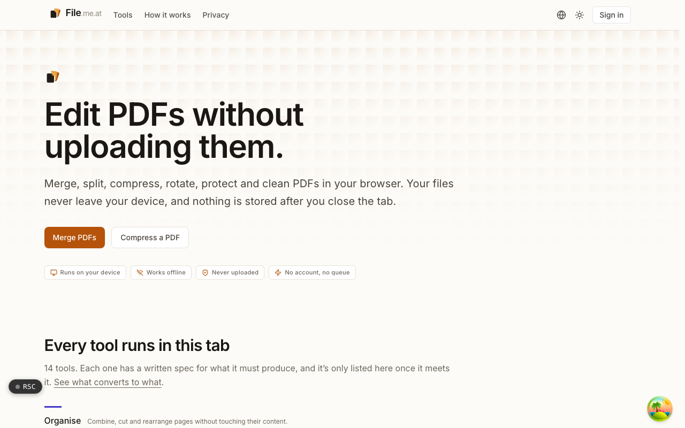
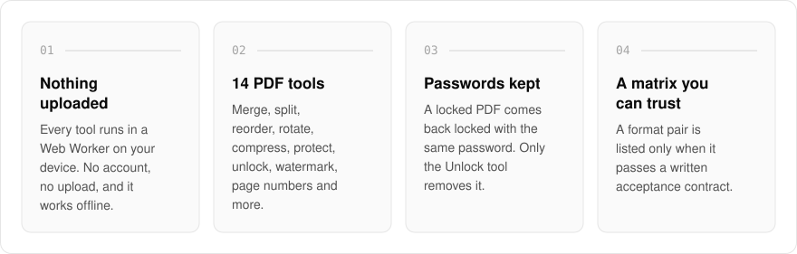
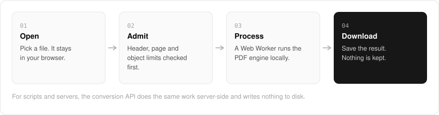
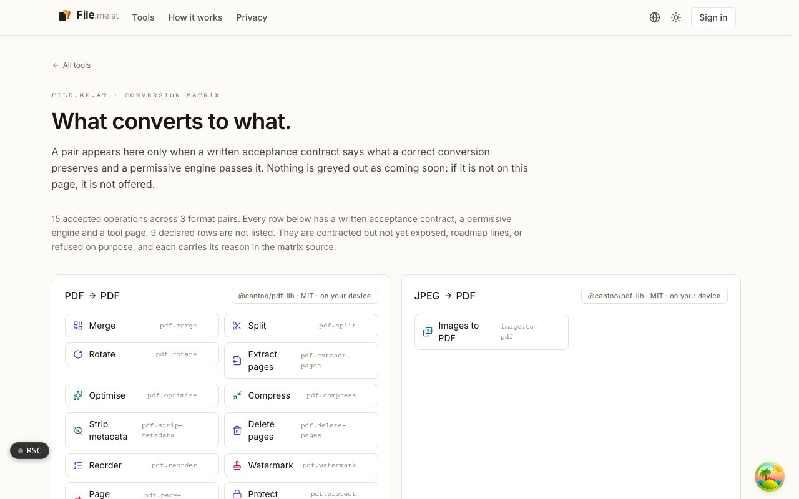
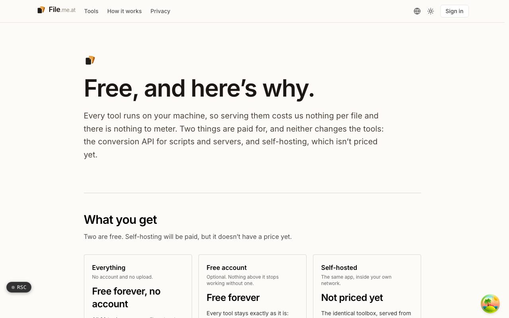

  <picture>
    <source media="(prefers-color-scheme: dark)" srcset=".github/assets/hero-dark.png">
    
  </picture>

<h1 align="center">file.me.at</h1>

<strong>Edit PDFs without uploading them.</strong>

  
  
  
  

  <a href="#features">Features</a> ·
  <a href="#how-it-works">How it works</a> ·
  <a href="#screenshots">Screenshots</a> ·
  <a href="#built-with">Built with</a>

Most online PDF tools want your contract, payslip or tax form on their server before they will merge two pages. I built file.me.at as a PDF toolbox that runs in your browser instead: merge, split, compress, rotate, protect and clean PDFs on your own device. The tools make no request carrying your file, there is no sign-in or server queue, and nothing is stored after you close the tab. For scripts and servers, a separate conversion API does the same work server-side.

  <picture>
    <source media="(prefers-color-scheme: dark)" srcset=".github/assets/overview-dark.svg">
    
  </picture>

## Why file.me.at

| The usual online PDF tool | file.me.at |
| --- | --- |
| Uploads your file to its server | Runs on your device in a Web Worker |
| Needs an account and a queue | No account, no queue, and it works offline |
| Drops the password when it saves | Returns a locked PDF locked with the same password |
| Greys out formats as "coming soon" | Lists a conversion only when it passes an acceptance contract |

## Features

- **14 browser tools**: merge, split, extract pages, delete pages, reorder and rotate; compress (lossless, balanced or small), optimise and strip metadata; protect (AES-256 with permissions) and unlock; watermark and page numbers; images (JPEG/PNG) to PDF.
- **Files never leave your device**: every tool runs in a Web Worker on an MIT-licensed PDF engine. No account, no upload, and it works offline.
- **The same checks as the server sandbox**: the PDF header check, page and object limits and password rules used for untrusted files run before a file is opened.
- **Passwords are never silently stripped**: a locked PDF opened with its password comes back locked with the same password. Only the Unlock tool removes encryption.
- **A conversion matrix you can trust**: a format pair is listed only when a written acceptance contract says what a correct conversion preserves and the engine passes it. Nothing is greyed out as coming soon.
- **Conversion API**: a stateless endpoint that takes a file and answers with the result (one file, or a ZIP for several), with nothing written to disk. In the hosted mode it is metered in credits with a spend cap and usage alerts; a self-host mode runs it without identity or metering.
- **Self-hostable**: the identical toolbox can run inside your own network.

## How it works

  <picture>
    <source media="(prefers-color-scheme: dark)" srcset=".github/assets/flow-dark.svg">
    
  </picture>

You pick a file and it stays in the browser. Before the parser sees it, the same admission checks the server sandbox uses for untrusted files run first: the PDF header, page and object limits, and password rules. A Web Worker then runs the PDF engine locally, and you download the result with nothing kept anywhere once the tab closes.

## Screenshots

<table>
  <tr>
    <td width="50%"><picture><source media="(prefers-color-scheme: dark)" srcset=".github/assets/formats-dark.png"></picture> Formats: the conversion matrix, listing accepted pairs only.</td>
    <td width="50%"><picture><source media="(prefers-color-scheme: dark)" srcset=".github/assets/pricing-dark.png"></picture> Pricing: free browser tools, a paid conversion API, and self-hosting.</td>
  </tr>
</table>

## Built with

  
  
  
  
  
  

- Next.js 16 (App Router), React 19, TypeScript
- Tailwind CSS 4
- `@cantoo/pdf-lib` running in a Web Worker
- oRPC with TanStack Query
- Drizzle ORM with Postgres
- Better Auth
- next-intl

## Part of the me.at family

file.me.at is one of my [`*.me.at`](https://me.at) apps. They share one design system, account, and app shell. Development happens in a private monorepo; this repository is the project's public-facing home.

## License

Source-available. See [LICENSE](LICENSE).
